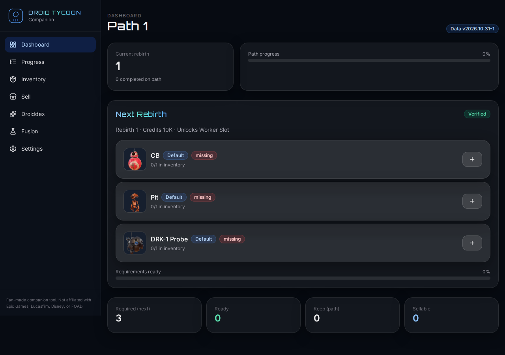
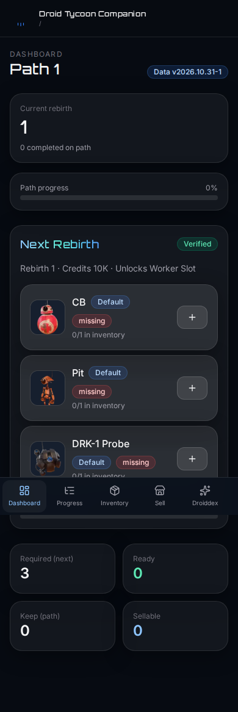

# Droid Tycoon Companion / Companheiro Droid Tycoon

**English:** Fan-made companion web app for [Star Wars Droid Tycoon](https://droidtycoonhelper.com/about/) (Fortnite UEFN island by FOAD, code **7865-8305-9184**). Track paths, rebirths, inventory, sell decisions, droid encyclopedia, and fusion recipes — 100% static, works offline after load.

**Português:** Ferramenta feita por fãs para jogadores de Droid Tycoon. Acompanhe path, rebirths, inventário, vendas, droiddex e fusões. Não é oficial.

**Production:** https://dthelper.kayooliveira.com (self-hosted via Coolify)

## Features

- Onboarding (path, rebirth progress, theme, inventory tracking)
- Dashboard with **Next Rebirth** requirements and status
- Progress (list + focus modes, complete/undo, Super Rebirth)
- Inventory (droid + **tier** + quantity)
- **Sell Center** — keep / sellable / upgrade analysis for remaining path rebirths
- Droiddex (101 droids, sources, confidence)
- Fusion Lab (17 recipes + rules, partial/single-source labeled)
- Settings — export/import JSON, data freshness, credits, reset
- LocalStorage persistence with schema versioning & migrations

## Screenshots

| Dashboard (desktop) | Dashboard (mobile) |
|---|---|
|  |  |

See also `docs/screenshots/` for Progress, Sell Center, Droiddex, Fusion Lab, Inventory, Settings.

## Data sources & confidence

- Primary: [droidtycoonhelper.com](https://droidtycoonhelper.com/) (game v1.37, checked 2026-10-31)
- Cross-check: [tycoon-tools.com](https://tycoon-tools.com/droid-tycoon/rebirth-requirements/)
- Images: Helper / [Fandom wiki](https://star-wars-droid-tycoon.fandom.com/) (CC BY-SA) — see `public/assets/droids/ATTRIBUTION.md`
- **Unconfirmed in UI:** Path 2 Rebirth 17 (R7 vs B2-RP), Path 6 Rebirth 19 (Proto-Roller Gold vs Diamond)
- Fusion data: single source → labeled **partial**
- Scourge-tier satisfies any requirement: **partial**, one source
- `staleAfterDays: 14` — stale banner in app when data is old

### Updating data

1. Run / adapt `scripts/parse.py` against droidtycoonhelper.com (see `docs/RESEARCH.md`)
2. Replace `src/data/gameData.json` and images under `public/assets/droids/`
3. Run `npm test` (includes validation that requirements reference real droids)

## Development

```bash
npm install
npm run dev          # Vite dev server (base path /)
npm run typecheck
npm test             # Vitest unit tests
npm run test:e2e     # Playwright smoke (+ screenshot spec)
npm run build
npm run preview      # test production build locally
```

### Docker (local)

```bash
docker build -t droid-tycoon-companion .
docker run --rm -p 8080:80 droid-tycoon-companion
# open http://localhost:8080
```

## Architecture

- **UI:** React 19 + TypeScript + Vite + Tailwind CSS v4 + Motion + lucide-react
- **State:** Zustand + persist (LocalStorage)
- **Routing:** HashRouter (deep links + refresh without server rewrites; nginx SPA fallback included for future BrowserRouter)
- **Domain:** Pure functions in `src/domain/` (sell logic, tiers, requirements, progress)
- **Adapters:** `src/storage/adapter.ts`, `src/data/dataSource.ts` (ready for future cloud/remote data)

## Deployment (Coolify + GHCR)

Private repo — **no GitHub Pages**. CI builds and pushes a container image; Coolify pulls and runs it as a **dockerimage** app.

1. **GitHub Actions** (`.github/workflows/image.yml`): on push to `current` (ignores `**.md` and `docs/**`) or `workflow_dispatch`:
   - Runs typecheck, tests, and Vite build
   - Builds Docker image and pushes to `ghcr.io/kayooliveira/droid-tycoon-companion`
   - Tags: `sha-<full-commit-sha>` and `current` (on default branch)
2. **Coolify:** configure app type **dockerimage**, image `ghcr.io/kayooliveira/droid-tycoon-companion:current` (or a specific `sha-…` tag), port **80**, domain **dthelper.kayooliveira.com**.

PRs run `.github/workflows/ci.yml` (verify only, no image push).

## Disclaimer

Fan-made companion tool. **Not affiliated with Epic Games, Lucasfilm, Disney, or FOAD.**

## License

App code: MIT (see repository). Game data/images remain under their respective sources (CC BY-SA for wiki images).
